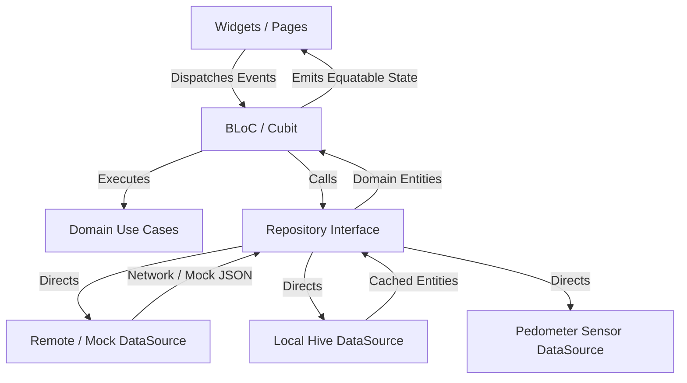
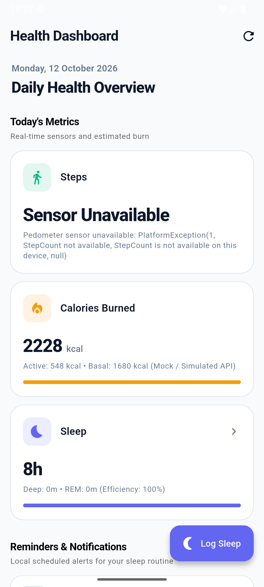
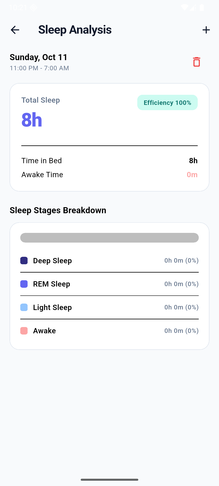
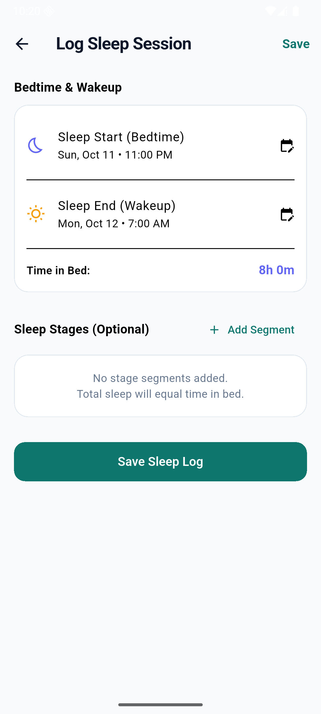

# Flutter Health Dashboard 

A production-oriented Flutter health dashboard app designed to track and visualize daily physical activity, calorie burn, and sleep cycles. Built following Clean Architecture principles, state management with BLoC, local persistence with Hive CE, and resilient offline capabilities.

---

## 1. Project Overview

The Health Dashboard provides users with a comprehensive view of their daily health metrics:
- **Steps Tracking**: Real-time pedometer readings calculating today's steps with daily baseline tracking and reboot compensation.
- **Calorie Expenditure**: Live integration with API Ninjas "Calories Burned" API and automatic fallback to a realistic simulated `CaloriesMockDataSource` when running without an API key.
- **Sleep Logging & Deep Analysis**: Manual logging interface supporting cross-midnight sleep sessions, granular stage segmentation (Deep, REM, Light, Awake), strict domain validation, and percentage breakdowns.
- **Offline Mode & Persistence**: Offline-first caching via Hive CE with automatic fallback and an informative `OfflineBanner`.
- **Scheduled Notifications**: Configurable local daily sleep reminders via `flutter_local_notifications` and `timezone` with zero third-party cloud services.

---

## 2. Flutter and Dart Versions Used

Developed and tested using:
```text
Flutter 3.38.7 • channel stable • https://github.com/flutter/flutter.git
Framework • revision 3b62efc2a3 (9 months ago) • 2026-01-13 13:47:42 -0800
Engine • hash 6f3039bf7c3cb5306513c75092822d4d94716003 (revision 78fc3012e4)
Tools • Dart 3.10.7 • DevTools 2.51.1
```

---

## 3. Setup and Run Instructions

### Prerequisites
1. Flutter SDK (3.38.x or compatible 3.x with Dart 3.x) installed and configured.
2. Android Studio / Xcode configured with an emulator, simulator, or physical device.

### Running with Mock Data Source (Default / Recommended for Reviewers)
To run the app immediately **without** providing any external API key:
```bash
flutter pub get
flutter run
```
When `CALORIES_API_KEY` is not provided, the dependency injection container automatically provisions the `CaloriesMockDataSource`, which simulates realistic BMR and active caloric burn derived from steps and realistic activity without requiring reviewer setup.

### Running with a Live Calories API Key
To connect to the live API Ninjas Calories Burned endpoint:
```bash
flutter run --dart-define=CALORIES_API_KEY=your_api_ninjas_key_here
```
*(See `.env.example` for details. Never commit real API keys to version control).*

---

## 4. Required Permissions and Platform Notes

### Android
Configured in `android/app/src/main/AndroidManifest.xml`:
- `android.permission.ACTIVITY_RECOGNITION`: Required for step counter and pedometer sensor access.
- `android.permission.INTERNET`: Required for Dio HTTP API calls.
- `android.permission.POST_NOTIFICATIONS`: Required for Android 13+ (API level 33+) local reminders.
- `android.permission.RECEIVE_BOOT_COMPLETED`: Reschedules alarms if needed after device reboots.
- `android.permission.SCHEDULE_EXACT_ALARM` & `USE_EXACT_ALARM`: Required for precise daily reminder notifications.

### iOS
Configured in `ios/Runner/Info.plist`:
- `NSMotionUsageDescription`: `"This app requires motion data to track your daily steps count."`
- User notifications permissions requested at runtime via Darwin initialization settings in `NotificationService`.

---

## 5. Architecture Overview

The app follows **Clean Architecture** organized with a **Feature-First** structure. No API calls, Hive storage access, or business logic exist inside widgets.

```
lib/
├── app.dart                   # Root MaterialApp with MultiBlocProvider
├── main.dart                  # App entry point, DI bootstrap, notification handling
├── hive_registrar.g.dart      # Generated Hive CE adapters registrar
├── core/
│   ├── di/                    # GetIt dependency injection setup (injection.dart)
│   ├── errors/                # Sealed Failure hierarchy & AppException classes
│   ├── network/               # DioClient (timeouts, error interceptors), NetworkInfo
│   ├── storage/               # HiveConstants, HiveService
│   ├── theme/                 # AppColors, AppTheme (Material 3 light/dark)
│   ├── utils/                 # DateFormatters, AppConstants
│   └── widgets/               # Reusable UI: ErrorView, OfflineBanner, LoadingView, SectionHeader
└── features/
    ├── dashboard/
    │   ├── data/
    │   │   ├── datasources/   # calories_remote_ds, calories_mock_ds, metrics_local_ds, steps_ds
    │   │   ├── models/        # CaloriesDataModel with Hive adapters & JSON DTO
    │   │   └── repositories/  # DashboardRepositoryImpl (cache fallback logic)
    │   ├── domain/
    │   │   ├── entities/      # CaloriesData, StepsData, DailyMetrics
    │   │   └── repositories/  # DashboardRepository (abstract contract)
    │   └── presentation/
    │       ├── bloc/          # DashboardBloc, StepsCubit, states and events
    │       ├── pages/         # DashboardPage
    │       └── widgets/       # MetricCard, DateHeader
    ├── sleep/
    │   ├── data/
    │   │   ├── datasources/   # SleepLocalDataSource (Hive)
    │   │   ├── models/        # SleepSessionModel, SleepSegmentModel (Hive adapters)
    │   │   └── repositories/  # SleepRepositoryImpl
    │   ├── domain/
    │   │   ├── entities/      # SleepSession, SleepSegment, SleepStage, SleepSummary
    │   │   ├── repositories/  # SleepRepository (abstract contract)
    │   │   └── usecases/      # CalculateSleepSummary, ValidateSleepSession
    │   └── presentation/
    │       ├── bloc/          # SleepBloc, SleepEvent, SleepState
    │       ├── pages/         # SleepLogPage (form), SleepDetailsPage
    │       └── widgets/       # SleepBreakdownBar, SleepStageLegend
    └── reminder/
        ├── data/              # NotificationService, ReminderLocalDataSource
        └── presentation/      # ReminderCubit, ReminderToggleCard
```

### Data Flow Diagram



---

## 6. State Management Approach (BLoC)

We utilize the **BLoC** (Business Logic Component) pattern (`flutter_bloc`, `bloc_concurrency`, `equatable`) for predictable, reactive, and testable state transitions:

### Blocs & Cubits
1. **`DashboardBloc`**:
   - **Events**: `DashboardStarted`, `DashboardRefreshed`, `DashboardRetried`.
   - **Transformer**: Uses `droppable()` from `bloc_concurrency` to ignore redundant concurrent requests.
   - **State**: `DashboardState` with `status` (`initial`, `loading`, `success`, `failure`), `calories`, `isOffline`, `lastUpdated`, and `errorMessage`.
   - **Transition Strategy**: Reads cached metrics first and displays them immediately. In parallel, refreshes from remote. If remote succeeds, writes to cache and displays live data (`isOffline: false`). If remote fails, remains in `success` mode with `isOffline: true` and presents the `OfflineBanner`. Only triggers `failure` when the network fails and no cached data exists.
2. **`StepsCubit`**:
   - Manages high-frequency pedometer step updates in an isolated Cubit.
   - **States**: `StepsInitial`, `StepsPermissionDenied`, `StepsLoaded(todaySteps, rawReading)`, `StepsUnavailable(message)`.
   - Keeps steps stream outside `DashboardBloc` so sensor ticks do not trigger unnecessary rebuilds of the whole dashboard.
3. **`SleepBloc`**:
   - **Events**: `SleepLogsRequested`, `SleepLogAdded`, `SleepLogDeleted`.
   - **States**: `SleepLoading`, `SleepLoaded(sessions)`, `SleepFailure(message)`.
   - Enforces domain validation through `ValidateSleepSession` prior to storing sessions in Hive.
4. **`ReminderCubit`**:
   - Manages daily sleep reminder scheduling, permission checks, and toggle preferences persisted in Hive.

### Performance Optimizations (Rebuild Prevention)
- **`BlocSelector`**: Used in `DashboardPage` so the Calories metric card only rebuilds when its specific tuple changes.
- **`buildWhen`**: Enforces strict conditions to skip rebuilding when only metadata timestamps change without state change.
- **`Equatable`**: Extended on all states, events, and domain entities to ensure value-equality comparison.
- **`const` constructors**: Employed across all stateless widgets, styles, and layouts.

---

## 7. API and Mock Data Approach

### Calories Source
- **Live Endpoint**: Uses **API Ninjas Calories Burned API** (`https://api.api-ninjas.com/v1/caloriesburned?activity=brisk+walking`).
- **Mock Source**: `CaloriesMockDataSource` implements the identical `CaloriesRemoteDataSource` interface.
  - Generates realistic daily expenditures (Basal Metabolic Rate ~1680 kcal + active calorie burn derived from pedometer steps: ~0.045 kcal/step or randomized daily baseline 520-640 kcal).
  - Simulates 400ms network latency to test loading indicators authentically.
  - Automatically activated whenever `CALORIES_API_KEY` is not provided.

---

## 8. Local Storage Choice: Hive CE

We selected **Hive CE** (`hive_ce` and `hive_ce_flutter` with code generation via `hive_ce_generator`):
- **Why Hive?**:
  - Ultra-fast, pure Dart key-value store with no native bridge overhead.
  - Perfect for structured document caching (e.g. `DailyMetrics`, `SleepSession` with nested `SleepSegment` lists) and simple settings (baselines, toggles).
  - Generated `TypeAdapter`s provide strong typing, high performance binary serialization, and zero reflection.
- **Trade-offs**:
  - Hive does not support complex relational queries, joins, or SQL indexing. If the app expands to multi-year relational trend analytics, an SQLite/relational abstraction like Drift would be the preferred alternative.

### Boxes
- `metrics_cache`: Stores latest cached calories model, date, and synchronization timestamp.
- `sleep_logs`: Stores sleep sessions with nested stage segments.
- `settings`: Stores the daily step baseline (count + date), reminder toggle, and custom reminder time.

---

## 9. Sleep Calculation Formulas

The domain usecase `CalculateSleepSummary` implements pure mathematical calculations isolated from any presentation widgets:

| Metric | Calculation Formula |
|---|---|
| **Time in Bed** | $\text{Sleep End} - \text{Sleep Start}$ |
| **Awake Time** | $\sum (\text{Awake Segment End} - \text{Awake Segment Start})$ |
| **Total Sleep** | $(\text{Sleep End} - \text{Sleep Start}) - \text{Awake Time}$ |
| **Deep Sleep** | $\sum (\text{Deep Segment End} - \text{Deep Segment Start})$ |
| **REM Sleep** | $\sum (\text{REM Segment End} - \text{REM Segment Start})$ |
| **Light Sleep** | $\sum (\text{Light Segment End} - \text{Light Segment Start})$ |
| **Sleep Efficiency** | $(\text{Total Sleep} / \text{Time in Bed}) \times 100\%$ |

---

## 10. Notification Approach

- Managed through `NotificationService` wrapping `flutter_local_notifications`, `timezone`, and `flutter_timezone`.
- Schedules a daily recurring notification ("Log Your Sleep") at 9:00 AM (or user-customized time) using `zonedSchedule` with `matchDateTimeComponents: DateTimeComponents.time`.
- Supports deep linking: tapping the notification immediately navigates to `SleepLogPage`.
- Requests explicit Android 13+ and iOS permissions before enabling.

---

## 11. Assumptions Made

1. **Pedometer Android Boot Steps**: Android's pedometer returns total steps since device boot. We assume that if `currentReading < baseline`, the device rebooted, and we immediately reset the baseline to `currentReading`.
2. **Reviewer Environment**: Assumed the reviewer will not have an API Ninjas key configured, so the app defaults to `CaloriesMockDataSource` automatically.
3. **Sleep Stage Segments**: Segments are optional; if no segments are provided for a session, awake time defaults to zero, and total sleep duration equals time in bed.

---

## 12. Known Limitations

1. **Desktop/Simulator Step Sensor**: Pedometer hardware sensors are not physically present on macOS desktop builds or standard emulators without mocked sensor injection; `StepsCubit` gracefully displays `Sensor Unavailable` with an explanation.
2. **Reboot Step Retention**: If an Android device reboots mid-day, steps accumulated before reboot are not currently recovered from historical step hardware logs because the hardware sensor counter restarts from zero.
3. **Sleep Stage Auto-Detection**: Sleep logging is manual as smart ring/watch integrations (e.g. Health Connect / Apple HealthKit) are outside the defined assessment scope.

---

## 13. Running Tests

Run the full test suite with:
```bash
flutter test
```

### Test Coverage Highlights (31 Unit & BLoC Tests)
- `CalculateSleepSummary`: normal session, cross-midnight sessions, zero awake time, empty stages, multiple segments of identical stages.
- `ValidateSleepSession`: end before start validation, out-of-bounds segment checks, overlapping segments detection.
- `DashboardRepositoryImpl`: cache fallback behavior, online caching, offline recovery, error bubbling.
- `DashboardBloc`: loading, success, offline cached fallback, failure without cache, refresh, retry.
- `StepsCubit`: daily baseline reset on date change, reboot counter drops, permission denials.
- `SleepBloc`: add, delete, and validation rejections.
- `ReminderCubit`: preference loading, permission requests, scheduling, toggles, time updates.

---

## 14. Architecture & UI Walkthrough

| Dashboard Screen | Sleep Analysis Screen | Log Sleep Form |
|:---:|:---:|:---:|
|  |  |  |
| Real-time Steps, Calories burn, and Sleep summary with offline support | Total sleep headline, efficiency rating, interactive stage breakdown bar & legend | Start/end datetime pickers crossing midnight, dynamic stage segment editor |
